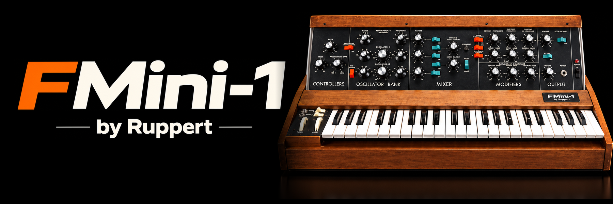
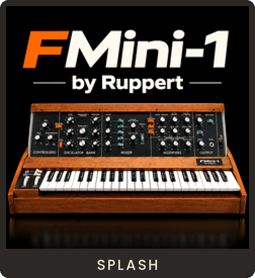
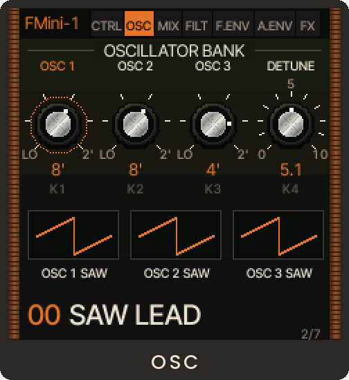
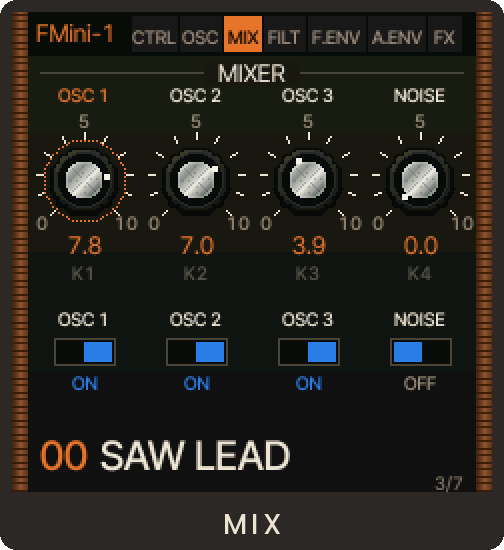
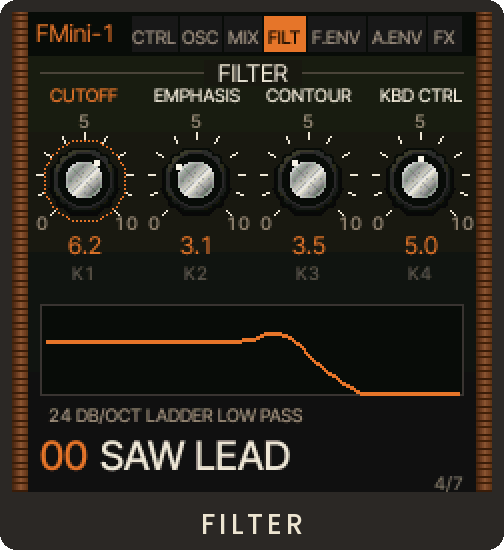
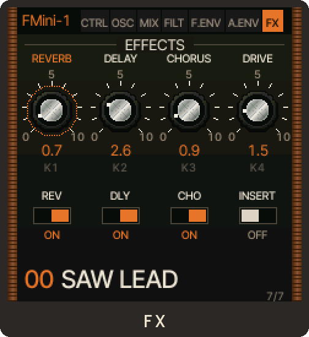
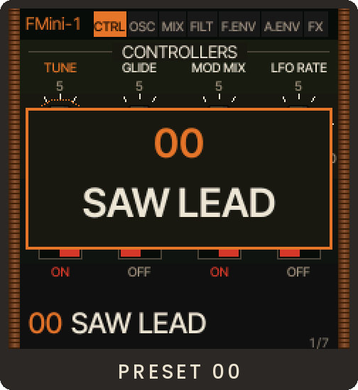
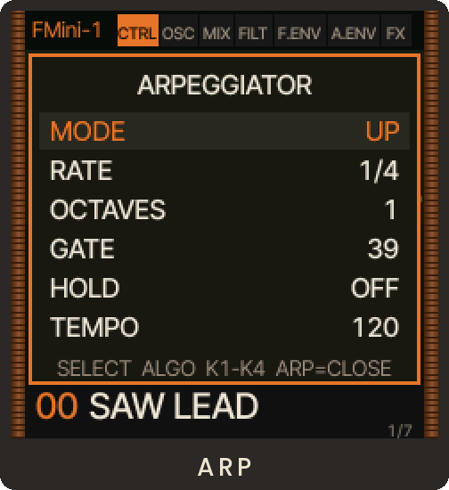
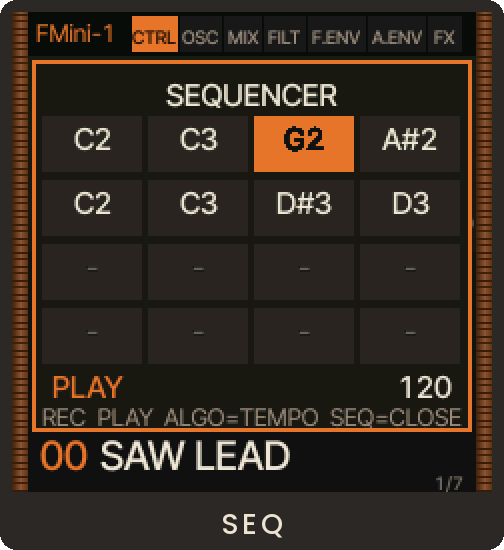

  

  Firmware that turns the <b>M-VAVE FM-1</b> keyboard into a three-oscillator monosynth in the spirit of the classic
  Moogs: a 24 dB/octave ladder filter, two contours, 100 factory patches, an arpeggiator, a sequencer and MIDI.

## 1. Screenshots

  
  
  
  

  
  
  
  

Based on <a href="https://github.com/hugelton/Felucca">Felucca</a> by Leo Kuroshita · <a href="LICENSE">GPL-3.0-only</a>

