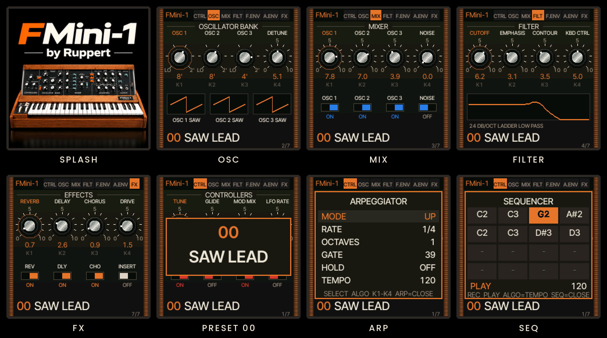

  

  Firmware que transforma o teclado <b>M-VAVE FM-1</b> num monossintetizador de três osciladores no espírito dos Moog
  clássicos: filtro ladder de 24 dB/oitava, dois contornos, 100 patches de fábrica, arpejador, sequenciador e MIDI.

  

   
  Chrome ou Edge · FM-1 conectado por USB

Baseado no <a href="https://github.com/hugelton/Felucca">Felucca</a>, de Leo Kuroshita · <a href="LICENSE">GPL-3.0-only</a>

