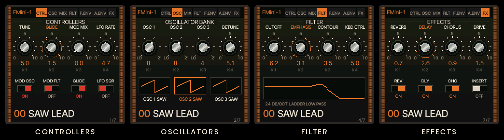
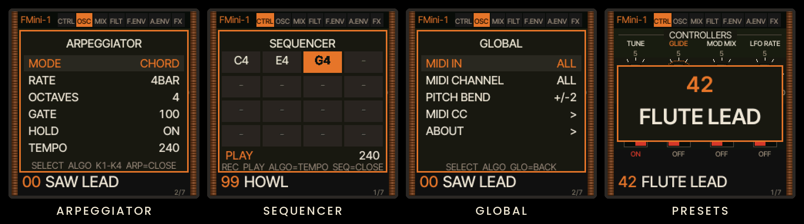

<p align="center">
  
</p>

<p align="center">
  <b>Um monossintetizador de três osciladores, no espírito dos Moog clássicos, para o teclado M-VAVE FM-1.</b><br>
  <sub>Firmware personalizado · baseado no <a href="https://github.com/hugelton/Felucca">Felucca</a></sub>
</p>

<p align="center">
  
  
  
  <a href="LICENSE"></a>
</p>

<p align="center">
  
</p>


O **FMini-1** transforma o FM-1 num sintetizador monofônico de um só propósito: três osciladores, um filtro ladder de
24 dB/oitava e dois contornos, tudo numa tela que imita o painel de um sintetizador de madeira, com botões de cabeça
prateada, chaves basculantes e gráficos do filtro e dos envelopes. Ao ligar, aparece o splash do *FMini-1 by Ruppert* por
3 segundos, e o primeiro patch já está pronto para tocar.

- **Monofônico de verdade.** Uma voz, prioridade para a nota mais grave. Uma tecla nova redispara os contornos e, com o
  GLIDE ligado, desliza até a nota.
- **100 patches de fábrica** e **32 slots seus** (U01 a U32), com nome editável.
- **Arpejador** (tap liga e desliga, segurar ativa o HOLD) e um **sequenciador de 16 notas** com REC e PLAY.
- **MIDI completo**: entrada por USB, pela porta MIDI ou pelas duas; canal ALL ou 1 a 16; faixa de pitch bend
  ajustável; e **cada botão, chave e forma de onda com seu próprio CC**, reaprendível na hora.
- **Efeitos**: reverb, delay, chorus e drive, cada um com seu nível e sua chave.

<p align="center"></p>


O caminho do sinal segue a arquitetura clássica:

```
 OSC 1 ─┐
 OSC 2 ─┼─▶ MIXER ──▶ LADDER 24 dB/oct ──▶ VCA ──▶ EFEITOS ──▶ saída
 OSC 3 ─┤   (overload)   ▲   ▲                ▲
 NOISE ─┘     contorno do filtro · teclado    contorno de volume
                 LFO / ruído (MOD MIX) ──▶ pitch (MOD OSC) e filtro (MOD FLT)
```

| Bloco | O que faz |
| --- | --- |
| **Osciladores** | Três VCOs com TRI, SHARK, SAW, SQR e pulso largo e estreito, sem aliasing (polyBLEP). Registros LO, 32', 16', 8', 4' e 2'. OSC 2 e 3 afinam ±7 semitons. Cada VCO começa levemente desafinado dos outros, como no analógico. |
| **Mixer** | Nível e chave para cada oscilador e para o ruído (branco ou rosa). A soma satura suavemente: o "overload" do original. |
| **Filtro** | Ladder de transistores de quatro estágios, 24 dB/oitava, com saturação em cada estágio. EMPHASIS chega à auto-oscilação. Tem acompanhamento de teclado (KBD CTRL). |
| **Contornos** | Filtro: ATTACK, DECAY, SUSTAIN e AMOUNT; o release usa o tempo do DECAY, como no Minimoog. Volume: ATTACK, DECAY, SUSTAIN e LEVEL, com ataque exponencial. |
| **Modulação** | LFO (triângulo ou quadrado) misturado ao ruído pelo MOD MIX, enviado ao pitch e/ou ao filtro. A roda de modulação controla a profundidade. |


A tela tem sete páginas, sempre com quatro knobs, que correspondem aos **KNOB 1 a 4** do FM-1.

| Página | Knobs | Chaves e caixas |
| --- | --- | --- |
| **CTRL** · Controllers | TUNE · GLIDE · MOD MIX · LFO RATE | MOD OSC · MOD FLT · GLIDE · LFO SQR |
| **OSC** · Oscillator bank | OSC 1 · OSC 2 · OSC 3 (registro) · DETUNE | a forma de onda de cada oscilador |
| **MIX** · Mixer | OSC 1 · OSC 2 · OSC 3 · NOISE | liga e desliga cada fonte |
| **FILT** · Filter | CUTOFF · EMPHASIS · CONTOUR · KBD CTRL | gráfico da resposta do filtro |
| **F.ENV** · Filter contour | ATTACK · DECAY · SUSTAIN · AMOUNT | gráfico do contorno |
| **A.ENV** · Loudness contour | ATTACK · DECAY · SUSTAIN · LEVEL | gráfico do contorno |
| **FX** · Effects | REVERB · DELAY · CHORUS · DRIVE | REV · DLY · CHO · INSERT |

Os botões do FM-1 ganham novas funções:

| Botão do FM-1 | No FMini-1 |
| --- | --- |
| **LFO** · **EDIT** · **SCL** · **ENV** · **FX** | Abrem CTRL · OSC · MIX (de novo: FILT) · F.ENV (de novo: A.ENV) · FX |
| **HOME** | Volta para CTRL e fecha qualquer pop-up |
| **SELECT** | Move o destaque por todos os controles; depois do último, passa para a próxima página |
| **ALGORITHM** | Altera o controle destacado (numa chave: direita liga, esquerda desliga) |
| **PRESETS** | Patch anterior ou próximo (os 100 de fábrica e depois os seus) |
| **SAVE** | Abre o diálogo de salvar: PRESETS escolhe o slot, SELECT e ALGORITHM editam o nome, SAVE grava |
| **ARP** | Toque liga e desliga o arpejador; segurado, liga e desliga o HOLD |
| **SEQ** · **REC** · **PLAY** | Abre o sequenciador · grava as próximas notas · toca e para o loop |
| **GLO** | Ajustes globais: MIDI IN, canal, pitch bend, mapa de CC e About |
| **OCT− / OCT+** | Oitava do teclado |

<p align="center">
  
</p>


Os dez primeiros patches são a vitrine do instrumento, cada um com efeitos próprios:

| | | | | |
| --- | --- | --- | --- | --- |
| `00` SAW LEAD | `01` SINE LEAD | `02` MOOG BASS | `03` ACID BASS | `04` 5TH LEAD |
| `05` PLUCK | `06` HARP | `07` JET | `08` SIREN | `09` WARM PAD |

Os outros 90 vão de baixos e leads a metais, madeiras, cordas, pads, órgão, teclas, percussão e efeitos (do LASER ao HOWL). A lista completa está em
[`firmware/src/eng_fmug_presets.h`](firmware/src/eng_fmug_presets.h), gerada por
[`tools/gen_fmug_presets.py`](tools/gen_fmug_presets.py). Program Change via MIDI também troca o patch.


> [!WARNING]
> A instalação é por sua conta e risco. A página do instalador tem a opção **Voltar ao V15 oficial**: com o arquivo
> `FM-1.fwsc` original da [M-VAVE](https://www.m-vave.com/download), ela faz backup e devolve o FM-1 ao firmware de
> fábrica.

1. **Compile** o pacote (veja [Compilar](#compilar)). O resultado é `build/felucca.fwsc`.
2. **Gere o instalador**, uma página única que já contém o firmware:
   ```sh
   python3 web/make_fmug_installer.py build/felucca.fwsc fmini-1-installer.html 1.4.1
   ```
3. **Abra a página** no Chrome ou no Edge. O Web MIDI com SysEx exige HTTPS ou `localhost`:
   ```sh
   python3 -m http.server 8000   # depois abra http://localhost:8000/fmini-1-installer.html
   ```
4. **Conecte o FM-1** por USB e clique em instalar. Não precisa de nenhum hardware extra.

Pelo terminal também funciona: `python3 tools/fm1_install.py build/felucca.fwsc` (requer `mido` e `python-rtmidi`).

<a id="compilar"></a>


```sh
git clone --recurse-submodules https://github.com/ruppert/fmini-1.git
cd fmini-1
./build.sh
```

O FMini-1 é o Felucca compilado com `FELUCCA_FMUG_ONLY=1` (o padrão neste repositório): só a tela e os controles do
sintetizador ([`fmug_app.c`](firmware/src/fmug_app.c)) sobre o motor de som, MIDI, USB e armazenamento do Felucca.
O som fica em [`eng_fmug.c`](firmware/src/eng_fmug.c). Pré-requisitos (toolchain JieLi, SDK AC79, Docker no macOS) e
detalhes estão em [BUILDING.md](BUILDING.md).

Para testar sem o hardware, `tests/run_tests.sh` desenha todas as telas com o código real e confere o mono, os
presets e o SAVE. As imagens deste README vêm daí, via [`tools/gen_readme_art.py`](tools/gen_readme_art.py).


**FMini-1 by Ruppert** é um firmware derivado do [**Felucca**](https://github.com/hugelton/Felucca), de Leo Kuroshita
([@kurogedelic](https://github.com/kurogedelic), [Hügelton Instruments](https://hugelton.com)). Todo o motor de som, MIDI,
USB, armazenamento e instalador vêm dele, e este projeto agradece muito por isso. Os demais créditos (motores,
fontes, samples e código de terceiros) estão em [CREDITS.md](CREDITS.md).

Licença **GPL-3.0-only** ([LICENSE](LICENSE)). Partes de terceiros mantêm suas próprias licenças: veja
[LICENSING.md](LICENSING.md) e [LICENSES/](LICENSES/).

<sub>Projeto independente, sem vínculo com a Moog Music ou a M-VAVE. Minimoog é marca registrada da Moog Music Inc.,
citada apenas como referência ao estilo do instrumento.</sub>

<p align="center"></p>
